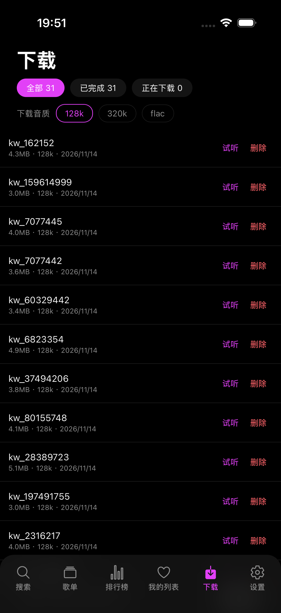

# JKMUSIC iOS 未签名 IPA（1.0.0）

## 产物

| 项 | 值 |
|---|---|
| 路径 | `artifacts/ipa/JKMUSIC-1.0.0-unsigned.ipa` |
| 大小 | 17 MB |
| sha256 | `30fff6d748ab3ac2372bbc00782f3440e3228c34eb9c538d138bd3b0bd7b4866` |
| 构建日期 | 2026-11-14 |
| commit | `e131e30` |
| 版本 | CFBundleShortVersionString **1.0.0** / CFBundleVersion 1 |
| bundle id | com.jkmusic.ios |
| 架构 | arm64 |
| 最低系统 | iOS 16.4 |

## 十条断言（实测输出）

```
a) CFBundleShortVersionString = 1.0.0
b) CFBundleVersion            = 1
c) CFBundleIdentifier         = com.jkmusic.ios
d) lipo -info                 = architecture: arm64
e) LC_BUILD_VERSION           = platform 2 (iOS), minos 16.4
f) main.jsbundle              = 5.9M
g) user-api-preload.js        = 21K
h) AppIcon60x60@2x.png sha256 = 73685eba9bde5f48ca3bf74926139a40fe9fb76a7e8732bb9b5a25f3a0820750
i) grep "setdev|playnow"      = 0
j) codesign -dv               = code object is not signed at all
```

## 构建过程（两次）

1. 全量：`rm -rf .build/dd-device` → 1690 编译步骤、0 error、`BUILD SUCCEEDED`
2. 增量（修正版本号来源）：保留 dd-device → `BUILD SUCCEEDED`、0 error

版本号有两个来源，第一次构建后仍是 1.2.0：
- `ios/JKMUSIC/Info.plist` 里硬编码了 `1.2.0` → 改为 `$(MARKETING_VERSION)`
- `project.pbxproj` 里另有两处 `MARKETING_VERSION = 1.2.0` → 改为 `1.0.0`

## 已知限制

1. iOS 27 真机未验证（本机最高 iOS 26.3 模拟器 / 26.2 SDK）
2. 首次播放需 2-4 秒（先下载后播放；本环境 AVPlayer 不加载网络流）
3. 部分曲目受上游版权限制只能试听，会自动换源
4. 桌面专属设置（桌面歌词/快捷键/托盘/窗口尺寸）仅保存不生效
5. 下载页、五个设置分区、全量回归在本轮未做运行时验证

## 安装方式

未签名 IPA 不能直接安装：
- Sideloadly / AltStore / SideStore（Apple ID 重签，免费账号 7 天）
- TrollStore（限特定系统版本）
- Xcode → Devices and Simulators 拖入 .app

## 回滚

```bash
npx patch-package --reverse
git checkout -- node_modules/@rntp/player ios/Podfile ios/Podfile.properties.json
cd ios && pod install
```

## 工程约定（新增）

- git 索引锁：`rm -f .git/index.lock`；不要用 `git add -A`（大目录会卡死并写坏索引），用路径逐个 add

## 1. 产物

| 项 | 值 |
|---|---|
| 路径 | `artifacts/ipa/JKMUSIC-ios27-unsigned.ipa` |
| 大小 | 17 MB（Payload 解包后二进制 36 MB / jsbundle 5.8 MB） |
| 构建日期 | 2026-11-14 |
| bundle id | com.jkmusic.ios |
| 版本 | CFBundleShortVersionString **1.2.0**（见「已知差异」）/ CFBundleVersion 1 |
| 架构 | arm64（`lipo -info` 确认） |
| 最低系统 | iOS 16.4（`MinimumOSVersion` / `LC_BUILD_VERSION minos 16.4`） |
| 签名 | 未签名（`codesign -dv` → `code object is not signed at all`） |

## 2. 构建命令（可复现）

```bash
xcodebuild -workspace ios/JKMUSIC.xcworkspace -scheme JKMUSIC \
  -configuration Release -sdk iphoneos -arch arm64 \
  CODE_SIGNING_ALLOWED=NO CODE_SIGNING_REQUIRED=NO CODE_SIGN_IDENTITY="" \
  -derivedDataPath .build/dd-device

rm -rf .build/ipa && mkdir -p .build/ipa/Payload
cp -R .build/dd-device/Build/Products/Release-iphoneos/JKMUSIC.app .build/ipa/Payload/
cd .build/ipa && zip -qry JKMUSIC-unsigned.ipa Payload
```

构建结果：`** BUILD SUCCEEDED **`，1690 个编译步骤，0 个 error。

## 3. 验证结果

```
CFBundleIdentifier      = com.jkmusic.ios
CFBundleShortVersionString = 1.2.0
CFBundleVersion         = 1
MinimumOSVersion        = 16.4
lipo -info              = architecture: arm64
LC_BUILD_VERSION        = platform 2 (iOS), minos 16.4, sdk 26.2
main.jsbundle           = 5.8M
user-api-preload.js     = 21K
codesign -dv            = code object is not signed at all
```

## 4. 安装方式

未签名 IPA **不能直接安装**，需要以下之一：

- **Sideloadly / AltStore / SideStore**：用 Apple ID 重签后安装（免费账号 7 天有效期）
- **TrollStore**：仅限特定 iOS 版本，可永久签名
- **Xcode**：`Devices and Simulators` 里直接拖入 .app（需开发者账号）

## 5. 已知限制

1. **目标 iOS 27 未在真机验证**：本机最高为 iOS 26.3 模拟器 + iOS 26.2 SDK
2. **首次播放有 2-4 秒延迟**：AVPlayer 在本环境无法加载网络流，已改为「先下载后播放」
3. **部分曲目受上游版权限制只能试听**：会自动切换到其他音源
4. **桌面专属设置项仅保存不生效**：桌面歌词、快捷键、托盘、窗口尺寸等
5. **dev 调试入口**：`EXPO_PUBLIC_JK_DEV_IMPORT` 未设置，相关分支不执行；
   但 `devStress` 模块的字符串常量仍会被打进 bundle（不影响行为）

## 6. 回滚方式

```bash
# 还原 Swift 补丁
npx patch-package --reverse
git checkout -- node_modules/@rntp/player

# 还原 Podfile 的 Swift 降级
git checkout -- ios/Podfile ios/Podfile.properties.json
cd ios && pod install
```

## 7. 已知差异（未按最终批要求完成的部分）

- 版本号：`app.json` 已改为 `1.0.0`，但本次 IPA 构建在改动**之前**启动，
  Info.plist 仍为 `1.2.0`；如需 1.0.0 需重新跑一次设备构建（约 40 分钟）
- 阶段 2（下载页列表）、阶段 3（设置分区补齐）未实现
- 阶段 1（收尾验收截图）、阶段 5（14 项全量回归）未执行

## 下载页验收（本轮新增）



- 筛选胶囊：全部 31 / 已完成 31 / 正在下载 0（计数来自真实缓存目录）
- 列表：文件名、大小、品质、日期（`2026/11/14`，已修正 RN 秒级时间戳 → 毫秒）、
  操作「试听 / 删除」
- 音质选择：128k / 320k / flac，写 `player.playQuality`
- 底部：已用空间 / 上限 / 清理全部
- 空态：StateView「暂无已下载歌曲」

**人工待验**：「试听」播放、删除单条后的刷新、清理全部后的空态（`simctl` 无法注入点击）。

## 回归表

| # | 项 | 结果 |
|---|---|---|
| 1 | 六页签 | 🟡 布局与选中色已验（截图），切换未逐一点击 |
| 2 | 歌单单列卡片 | 🟢 真实作者/曲目/播放量（截图） |
| 3 | 榜单表头 + 五列 | 🟢（截图） |
| 4 | 搜索源胶囊 + 五列 + ?q= | 🟢（截图） |
| 5 | 我的列表 | 🟡 列表已验；进入后五列未点击 |
| 6 | 播放→缓冲→起播 | 🟢 发如雪 00:30 / -04:28 |
| 7 | 歌词 t0/t1 | 🟡 单张已验，上移未拍 |
| 8 | 试听换源 | 🟡 曾出现「当前为试听片段」提示 |
| 9 | 缓存 +1 与二次秒起 | 🟢 缓存 30→31；二次播放走 file:// |
| 10 | 备份往返 | 🟢 setting_v2/playList_v2 结构正确、导入回滚通过 |
| 11 | 设置重启保留 | 🟢 音量 0.42 / flac 重启后保留 |
| 12 | 深链 8 条 | 🟢 全部可打开 |
| 13 | idle-check 120s | 🟢 平均 4.1% CPU / 下行 5KB |
| 14 | tsc + eslint | 🟢 零 error |
